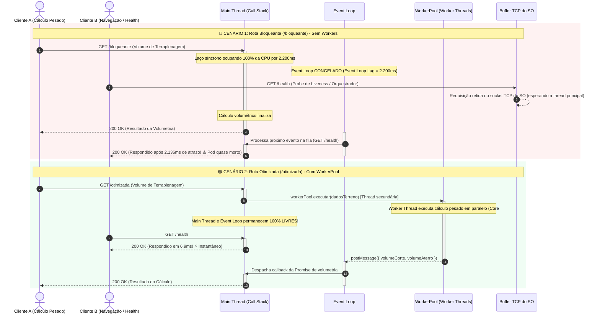

# Mapa Visual da Arquitetura do Node.js: Event Loop, Concorrência e Workers

Este documento complementa o [EXPERIMENTO_EVENT_LOOP.md](file:///c:/Users/Bruno/Documents/Projetos/labs/lab-node-architecture/docs/EXPERIMENTO_EVENT_LOOP.md), trazendo uma representação visual aprofundada da infraestrutura interna do Node.js modelada integralmente em diagramas **Mermaid**.

---

## 1. Diagrama Geral da Arquitetura do Runtime Node.js

O diagrama abaixo mapeia como os componentes do Node.js interagem dentro do mesmo processo do Sistema Operacional: a **Thread Principal** (com V8, Call Stack e Event Loop), a **libuv** (I/O do Kernel e Threadpool interna) e o paralelismo em múltiplos núcleos com **`node:worker_threads`** e **[`WorkerPool`](file:///c:/Users/Bruno/Documents/Projetos/labs/lab-node-architecture/src/workers/worker-pool.ts)**.

```mermaid
flowchart TB
    %% ========================================================
    %% ESTILOS VISUAIS
    %% ========================================================
    classDef mainThreadStyle fill:#eff6ff,stroke:#2563eb,stroke-width:2px,color:#1e3a8a;
    classDef stackStyle fill:#fef9c3,stroke:#ca8a04,stroke-width:2px,color:#854d0e;
    classDef alertStyle fill:#fee2e2,stroke:#dc2626,stroke-width:2px,stroke-dasharray:4 4,color:#991b1b;
    classDef eventLoopStyle fill:#f3e8ff,stroke:#7e22ce,stroke-width:2px,color:#581c87;
    classDef libuvStyle fill:#f0fdf4,stroke:#16a34a,stroke-width:2px,color:#14532d;
    classDef workerStyle fill:#fff7ed,stroke:#ea580c,stroke-width:2px,color:#7c2d12;
    classDef childStyle fill:#f8fafc,stroke:#475569,stroke-width:2px,stroke-dasharray:5 3,color:#334155;

    %% ========================================================
    %% PROCESSO PRINCIPAL DO NODE.JS
    %% ========================================================
    subgraph ProcessoNode ["📦 PROCESSO NODE.JS (SO PID) • os.availableParallelism()"]
        direction TB

        %% MAIN THREAD
        subgraph MainThreadBox ["🧵 MAIN THREAD (Single-Threaded • V8 Isolate Principal)"]
            direction TB

            V8["⚡ Motor V8 (Google)<br/><i>JIT Compiler • Heap • Garbage Collector</i>"]:::mainThreadStyle

            subgraph StackZone ["Execução Síncrona"]
                CallStack["📚 Call Stack (Pilha de Execução)<br/><i>Executa JS linha por linha</i>"]:::stackStyle
                CPUBoundAlert["⚠️ TAREFA CPU-BOUND<br/><b>🔥 Congela a Call Stack!</b><br/><i>(Causa Event Loop Lag Infinito)</i>"]:::alertStyle
            end

            subgraph EventLoopBox ["🔄 EVENT LOOP (Orquestrador Assíncrono da libuv)"]
                direction TB
                EL1["1. Microtasks Queue<br/><i>Promise.then, queueMicrotask</i>"]
                EL2["2. Timers Phase<br/><i>setTimeout, setInterval</i>"]
                EL3["3. Poll Phase & I/O Callbacks<br/><i>Sockets TCP/HTTP, FS prontos</i>"]
                EL4["4. Check Phase<br/><i>setImmediate (Chunking)</i>"]
                EL5["5. Close Callbacks<br/><i>socket.on('close')</i>"]
                
                EL1 --> EL2 --> EL3 --> EL4 --> EL5 --> EL1
            end:::eventLoopStyle

            CallStack -.->|"Se ocupada com cálculo pesado"| CPUBoundAlert
            CallStack <==>|"Despacha callbacks quando pilha esvazia"| EventLoopBox
        end:::mainThreadStyle

        %% CAMADA LIBUV & KERNEL
        subgraph LibuvZone ["🌐 CAMADA LIBUV & S.O. (Multi-Threaded I/O Assíncrono)"]
            direction TB

            subgraph KernelIO ["🚀 I/O Não-Bloqueante (Kernel do S.O.)"]
                NetSockets["Sockets TCP / HTTP<br/><i>(epoll, kqueue, IOCP)</i>"]
                DNSLookup["Resolução DNS Assíncrona"]
            end:::libuvStyle

            subgraph LibuvThreadpool ["🧵 libuv Threadpool (4 threads padrão C/C++)"]
                FS["File System (fs.readFile, fs.writeFile)"]
                Crypto["Criptografia Nativa (crypto.pbkdf2)"]
                Zlib["Compressão de Dados (zlib)"]
            end:::libuvStyle
        end:::libuvStyle

        %% CAMADA WORKER THREADS
        subgraph WorkerZone ["⚙️ node:worker_threads & WorkerPool (Multi-Core Real)"]
            direction TB
            PoolManager["Gerenciador do WorkerPool<br/><i>Fila FIFO & Rastreamento de Estado</i>"]:::workerStyle

            subgraph WorkersList ["Threads Reais Paralelas"]
                W1["Worker 1 (V8 Isolate #1)<br/>🟢 Ocioso (Idle)"]:::workerStyle
                W2["Worker 2 (V8 Isolate #2)<br/>🔥 Ocupado: Cálculo Volumétrico"]:::workerStyle
                WN["Worker N (V8 Isolate #N)<br/>🟢 Ocioso (Idle)"]:::workerStyle
            end

            Comms["Canais de Troca de Dados:<br/>• postMessage (Structured Clone)<br/>• SharedArrayBuffer / Transferable Objects (Zero-Copy)"]
            
            PoolManager --> W1
            PoolManager --> W2
            PoolManager --> WN
            WorkersList -.-> Comms
        end:::workerStyle

    end

    %% PROCESSO FILHO FORK (EXTERNO AO PROCESSO PAI)
    subgraph ForkZone ["🔀 PARALELISMO MULTI-PROCESSO (Alternativa Externa)"]
        ChildProcess["child_process.fork()<br/><i>Processo Filho Separado no SO • Heap e PID Próprios<br/>⚠️ Consumo maior de memória RAM (~30MB+)</i>"]:::childStyle
    end

    %% ========================================================
    %% RELAÇÕES E FLUXO ENTRE AS CAMADAS
    %% ========================================================
    CallStack ==>|"1. Dispara I/O Assíncrono"| LibuvZone
    LibuvZone ==>|"2. I/O concluído registra Callback na fila"| EventLoopBox

    CallStack ==>|"3. Offloading de Cálculo Pesado"| PoolManager
    Comms ==>|"4. Retorna resultado via evento de mensagem"| EventLoopBox

    CallStack -.->|"Dispara processo isolado"| ChildProcess
```

---

## 2. Comparativo de Fluxo no Tempo: Rota Bloqueante vs. Rota com Worker Threads

O diagrama de sequência abaixo demonstra o impacto prático de cada abordagem quando dois usuários acessam a API concorrentemente:



---

## 3. As 5 Fases do Event Loop em Detalhes

Para entender quando cada tipo de operação é atendida pelo Node.js, este diagrama de ciclo mostra as fases executadas a cada iteração (*tick*) do Event Loop:

```mermaid
stateDiagram-v2
    direction TB

    [*] --> Microtasks : Entrada ou retorno de qualquer fase
    
    state "0. Microtasks (Fila de Prioridade Máxima)" as Microtasks {
        [*] --> ProcessNextTick : process.nextTick()
        ProcessNextTick --> PromiseQueue : Promise.then() / catch / finally
        PromiseQueue --> [*]
    }
    
    Microtasks --> TimersPhase : Esvaziou microtasks
    
    state "1. Timers Phase" as TimersPhase {
        note right of TimersPhase : Executa callbacks agendados por setTimeout() e setInterval() cujo limiar expirou.
    }

    TimersPhase --> Microtasks1 : Checa microtasks
    state "Microtasks" as Microtasks1
    Microtasks1 --> PendingIO : Esvaziou microtasks

    state "2. Pending Callbacks" as PendingIO {
        note right of PendingIO : Processa callbacks de I/O postergados (ex: erros de rede em certas plataformas).
    }

    PendingIO --> PollPhase : Avança
    
    state "3. Poll Phase (Coração do I/O)" as PollPhase {
        note right of PollPhase : Recupera novos eventos de I/O do SO (Sockets, HTTP, Leitura de Disco). Se a fila estiver vazia, aguarda novos eventos até o limiar de timer mais próximo.
    }

    PollPhase --> CheckPhase : Se há setImmediate() agendado
    
    state "4. Check Phase (setImmediate)" as CheckPhase {
        note right of CheckPhase : Executa callbacks agendados com setImmediate(). Técnica ideal para 'Chunking' de rotinas longas.
    }

    CheckPhase --> CloseCallbacks : Avança

    state "5. Close Callbacks" as CloseCallbacks {
        note right of CloseCallbacks : Executa eventos de fechamento: socket.on('close', ...)
    }

    CloseCallbacks --> MicrotasksFinal : Checa microtasks
    state "Microtasks" as MicrotasksFinal
    MicrotasksFinal --> [*] : Ciclo reinicia ou processo encerra se não há mais tarefas ativas
```

---

## 4. Matriz de Correlação das Palavras-Chave

| Palavra-Chave | Localização no Diagrama | Responsabilidade Arquitetural |
| :--- | :--- | :--- |
| **Event Loop** | Centro da *Main Thread* | Orquestra a ordem de resolução de timers, I/O e microtasks; só despacha quando a Call Stack está vazia. |
| **Main Thread** | Caixa azul principal | Thread única que executa o código JavaScript do desenvolvedor. |
| **Call Stack** | Topo da *Main Thread* | Pilha de execução síncrona. Quando ocupada por uma função contínua, congela o processo. |
| **V8 & V8 Isolate** | Motor JavaScript | O motor V8 compila e roda JS. Cada Worker Thread possui seu próprio *V8 Isolate* com heap isolado. |
| **libuv** | Camada verde inferior | Biblioteca em C/C++ que gerencia o loop de eventos, I/O não-bloqueante e a *threadpool* para tarefas de disco e crypto. |
| **I/O Não-Bloqueante** | Módulo Kernel do S.O. | Delegado ao kernel (epoll/kqueue); o Node não gasta tempo de CPU esperando respostas de rede. |
| **CPU-Bound** | Alerta vermelho na Call Stack | Tarefas pesadas de cálculo. Devem ser obrigatoriamente retiradas da Main Thread em produção. |
| **Event Loop Lag** | Métrica de atraso no Event Loop | O tempo que requisições ficam presas esperando a Call Stack ser liberada. |
| **`setImmediate`** | Fase *Check* do Event Loop | Permite fatiar (*chunking*) tarefas grandes, cedendo o controle para o Event Loop entre frações de cálculo. |
| **`node:worker_threads`** | Caixa laranja de Workers | Módulo padrão para criar threads reais compartilhando o mesmo processo. |
| **[`WorkerPool`](file:///c:/Users/Bruno/Documents/Projetos/labs/lab-node-architecture/src/workers/worker-pool.ts)** | Gerenciador do pool | Evita criar/destruir workers dinamicamente; mantém threads prontas com fila FIFO e autorrecuperação. |
| **`child_process.fork`** | Caixa tracejada externa | Cria um novo processo no SO com PID e memória completamente independentes. |
| **`postMessage`** | Seta de comunicação | Canal de troca de mensagens com cópia serializada (*Structured Clone*). |
| **Transferable Objects** | Rodapé da camada de Workers | Permite transferir a propriedade de memória (`ArrayBuffer`) com zero cópia (*Zero-Copy*). |
| **`os.availableParallelism()`** | Cabeçalho do Processo | Retorna a contagem exata de núcleos lógicos para dimensionar o número ideal de threads sem sobrecarregar o SO. |
