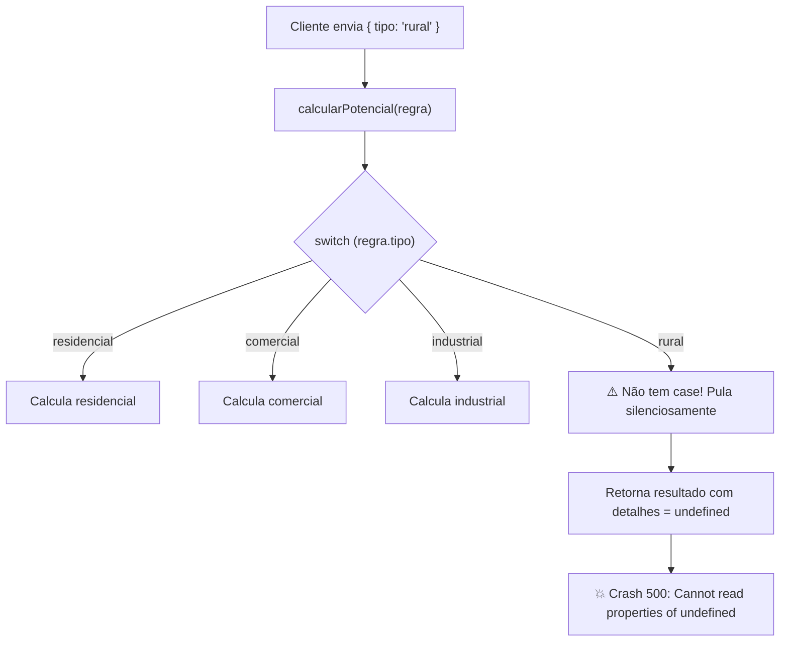

# Guia Prático: Modelagem de Domínio Estrita, Type Erasure e Arquitetura Node.js & TypeScript

Este documento aprofunda os conceitos arquiteturais implementados nas **Tarefas 1 e 2** do projeto `lab-node-architecture`. Cada tópico aborda:
1. **O que é o conceito?**
2. **Existe no JavaScript? (Comparação JS vs. TS)**
3. **Qual é o problema real em produção?**
4. **Como simular o problema na prática?**
5. **Explicação da solução de engenharia**
6. **Código da solução e como testar**

Também disponibilizamos um laboratório visual interativo em [`docs/laboratorio-interativo.html`](file:///c:/Users/Bruno/Documents/Projetos/labs/lab-node-architecture/docs/laboratorio-interativo.html).

---

## 1. Checagem Exaustiva (`assertNever`) em Discriminated Unions

### 1.1 O que é?

É uma técnica de compilador em TypeScript para garantir que, ao tratar uma união de tipos discriminados (como `RegraResidencial | RegraComercial | RegraIndustrial`), **100% das variantes possíveis sejam obrigatoriamente implementadas** em um `switch` ou sequência de `if`.

A função base é extremamente enxuta:
```ts
export function assertNever(x: never): never {
  throw new Error(`Caso não tratado no switch exaustivo: ${JSON.stringify(x)}`);
}
```

### 1.2 Existe no JavaScript? (Comparação JS vs. TS)

| Aspecto | JavaScript Puro | TypeScript com `assertNever` |
| :--- | :--- | :--- |
| **Suporte à checagem** | **NÃO existe**. JavaScript não tem sistema de tipos estático nem o tipo `never`. | **Suporte nativo**. O compilador valida todos os ramos do switch. |
| **Quando ocorre o erro?** | Somente em **tempo de execução** (runtime), quando um usuário faz uma requisição com o caso novo. | Em **tempo de compilação** (`npm run typecheck` ou build). O código nem sequer gera build se faltar um caso. |
| **Comportamento se esquecer um caso** | O `switch` pula sem executar nada, a função retorna `undefined` silenciosamente. | O compilador emite o erro `TS2345: Argument of type 'X' is not assignable to parameter of type 'never'`. |
| **Impacto no sistema** | Cria **bugs fantasmas** e quebra tardiamente com `TypeError: Cannot read properties of undefined`. | **Segurança absoluta**: qualquer desenvolvedor que adicionar uma nova regra é obrigado a implementar o cálculo. |

### 1.3 O Problema Real em Produção

Imagine a seguinte situação na **ArqLab**:
1. O time de negócios cria uma nova zona urbanística: a **Zona Rural** (`{ tipo: 'rural', areaMinimaHectares: number }`).
2. O desenvolvedor cadastra a nova regra no modelo de dados, mas **esquece** de atualizar o motor de cálculo (`calculo-potencial.service.ts`).
3. Sem checagem exaustiva:
   - O `switch` não tem o `case 'rural'`.
   - A função `calcularPotencialConstrutivo` finaliza sem entrar em nenhum `case`.
   - A propriedade `detalhes` fica `undefined`.
   - Mais à frente, quando a API tenta responder ou gravar o projeto no banco de dados, a aplicação quebra com **HTTP 500** ou grava registros corrompidos com valores `undefined`/`NaN`.



### 1.4 Como Simular o Problema na Prática

#### Forma A: Via Laboratório Visual Interativo
Abra [`docs/laboratorio-interativo.html`](file:///c:/Users/Bruno/Documents/Projetos/labs/lab-node-architecture/docs/laboratorio-interativo.html) no navegador e clique em **"Simular Bug em Produção (JavaScript)"** e depois em **"Executar com Proteção assertNever"**.

#### Forma B: Simulando a Falha no Próprio Compilador TypeScript
1. Abra o arquivo [`src/domain/zoneamento.types.ts`](file:///c:/Users/Bruno/Documents/Projetos/labs/lab-node-architecture/src/domain/zoneamento.types.ts).
2. Adicione uma nova variante à união `RegraZoneamento`:
   ```ts
   export interface RegraRural {
     tipo: 'rural';
     areaMinimaHectares: number;
   }

   export type RegraZoneamento =
     | RegraResidencial
     | RegraComercial
     | RegraIndustrial
     | RegraRural; // <-- Nova regra adicionada!
   ```
3. Sem mexer no arquivo [`src/domain/calculo-potencial.service.ts`](file:///c:/Users/Bruno/Documents/Projetos/labs/lab-node-architecture/src/domain/calculo-potencial.service.ts), rode o comando de verificação:
   ```bash
   npm run typecheck
   ```
4. **Veja o resultado**: O compilador TypeScript recusa o código antes de qualquer build:
   ```text
   src/domain/calculo-potencial.service.ts(75,26): error TS2345: 
   Argument of type 'RegraRural' is not assignable to parameter of type 'never'.
   ```

### 1.5 A Solução Arquitetural

No arquivo [`src/domain/calculo-potencial.service.ts`](file:///c:/Users/Bruno/Documents/Projetos/labs/lab-node-architecture/src/domain/calculo-potencial.service.ts), o `switch` utiliza a união discriminada. À medida que cada `case` é avaliado, o TypeScript elimina essa possibilidade do tipo de `regraZoneamento` (técnica chamada de **Type Narrowing**).

Se todos os casos forem tratados, no bloco `default`, o tipo resultante da variável é matematicamente o conjunto vazio: **`never`**.

```ts
switch (regraZoneamento.tipo) {
  case 'residencial':
    // Aqui regraZoneamento é estritamente RegraResidencial
    break;

  case 'comercial':
    // Aqui regraZoneamento é estritamente RegraComercial
    break;

  case 'industrial':
    // Aqui regraZoneamento é estritamente RegraIndustrial
    break;

  default:
    // Se todos os casos acima foram cobertos, o TypeScript sabe que
    // regraZoneamento é do tipo 'never'.
    // Se faltou algum caso (ex: RegraRural), regraZoneamento terá o tipo RegraRural,
    // que NÃO pode ser passado para uma função que espera 'never'.
    return assertNever(regraZoneamento);
}
```

---

## 2. Branded Types (Tipagem Nominal vs. Tipagem Estrutural)

### 2.1 O que é?

Por padrão, o TypeScript adota **Tipagem Estrutural (Duck Typing)**: se duas coisas têm o mesmo formato de dados primitivo, o TypeScript as considera idênticas.

Por exemplo:
```ts
type ProjetoId = string;
type UsuarioId = string;
```
Para o TypeScript, `ProjetoId` e `UsuarioId` são exatamente a mesma coisa: apenas `string`.

**Branded Types (Tipos Nominais)** é o padrão de engenharia que anexa uma "marca" única (um símbolo ou propriedade fantasma) ao tipo primitivo, forçando o compilador a tratá-los como tipos totalmente distintos e incompatíveis.

### 2.2 O Problema Real em Produção

Considere o seguinte método de repositório:
```ts
async function deletarProjeto(projetoId: string, autorId: string): Promise<void> {
  await db.query('DELETE FROM projetos WHERE id = $1 AND autor_id = $2', [projetoId, autorId]);
}
```

Se por engano o programador inverter a ordem dos argumentos:
```ts
const usuarioLogadoId = "usr_45892";
const projetoAtualId = "prj_10023";

// ❌ O programador inverteu os parâmetros:
await deletarProjeto(usuarioLogadoId, projetoAtualId);
```

- **O que o TypeScript comum faz?** Aceita com louvor! Ambos são `string`.
- **O que acontece no banco de dados?** A query busca `WHERE id = 'usr_45892' AND autor_id = 'prj_10023'`. Não deleta o projeto ou, pior, deleta registros errados se os formatos forem parecidos.

O mesmo desastre ocorre na engenharia civil e cálculos urbanísticos com grandezas físicas:
- `areaTerreno: number` (m²)
- `recuoFrontal: number` (metros lineares)

Um programador desatento pode fazer: `areaTerreno + recuoFrontal`. O TypeScript aceita (é `number + number`), mas somar área com comprimento linear é um erro conceitual gravíssimo!

### 2.3 A Solução com Branded Types

No arquivo [`src/domain/branded-types.ts`](file:///c:/Users/Bruno/Documents/Projetos/labs/lab-node-architecture/src/domain/branded-types.ts), implementamos:

```ts
declare const __brand: unique symbol;

export type Brand<T, B extends string> = T & { readonly [__brand]: B };

export type ProjetoId = Brand<string, 'ProjetoId'>;
export type UsuarioId = Brand<string, 'UsuarioId'>;
export type MetrosQuadrados = Brand<number, 'MetrosQuadrados'>;
export type MetrosLineares = Brand<number, 'MetrosLineares'>;
```

E criamos **funções de fábrica (smart constructors)** que garantem validação no runtime:

```ts
export function toProjetoId(id: string): ProjetoId {
  if (typeof id !== 'string' || id.trim().length === 0) {
    throw new Error('ProjetoId inválido: deve ser uma string não vazia.');
  }
  return id as ProjetoId;
}
```

Agora, o código fica blindado:
```ts
function deletarProjeto(projetoId: ProjetoId, autorId: UsuarioId) { ... }

// Ao tentar inverter:
deletarProjeto(usuarioLogadoId, projetoAtualId);
// ❌ ERRO TS2345: Argument of type 'UsuarioId' is not assignable to parameter of type 'ProjetoId'.
```

#### Como Testar
Você pode testar a interatividade no [`docs/laboratorio-interativo.html`](file:///c:/Users/Bruno/Documents/Projetos/labs/lab-node-architecture/docs/laboratorio-interativo.html) (Aba 2) ou rodar a suite automatizada de testes que cobre Branded Types:
```bash
npm test test/calculo-potencial.test.ts
```

---

## 3. Validação de Borda (Zod) e Type Erasure

### 3.1 O que é Type Erasure?

O Node.js **não executa TypeScript**. Ele executa JavaScript puro.  
No momento em que o código é transpilado ou executado (seja pelo `tsc`, `tsx` ou `esbuild`), **todas as declarações de tipo, interfaces e branded types são 100% apagadas do arquivo final**. Isso é chamado de **Type Erasure**.

### 3.2 O Problema Real na Borda da API (HTTP)

Quando uma requisição `POST` chega pela rede na rota Fastify:
```ts
app.post('/api/zoneamento/calcular', async (request, reply) => {
  // O desenvolvedor faz um cast ingênuo:
  const dados = request.body as DadosProjetoUrbanistico;
  
  // Em runtime, o TypeScript NÃO EXISTE MAIS!
  // Se o cliente HTTP enviou: { areaTerreno: -1000, regraZoneamento: { tipo: "rural" } }
  // A variável 'dados' aceita qualquer lixo JSON que veio na rede!
});
```

Se a aplicação confiar apenas nas tipagens do TypeScript para dados que vêm de fora (rede, formulários, webhooks, arquivos), o sistema sofrerá ataques, falhas de segurança e cálculos com dados inválidos.

### 3.3 A Solução: Zod como Guardião de Borda

No arquivo [`src/schemas/potencial-construtivo.schema.ts`](file:///c:/Users/Bruno/Documents/Projetos/labs/lab-node-architecture/src/schemas/potencial-construtivo.schema.ts), definimos o schema executável em runtime utilizando `z.discriminatedUnion`:

```ts
export const regraZoneamentoSchema = z.discriminatedUnion('tipo', [
  regraResidencialSchema,
  regraComercialSchema,
  regraIndustrialSchema,
]);

export const calcularPotencialBodySchema = z.object({
  projetoId: z.string().min(1),
  usuarioId: z.string().min(1),
  areaTerreno: z.number().positive(),
  testadaPrincipal: z.number().positive(),
  regraZoneamento: regraZoneamentoSchema,
});
```

E na rota Fastify [`src/routes/potencial-construtivo.routes.ts`](file:///c:/Users/Bruno/Documents/Projetos/labs/lab-node-architecture/src/routes/potencial-construtivo.routes.ts):
```ts
const dadosValidados = parseAndValidatePotencialInput(request.body);
```

Se o cliente enviar qualquer dado inconsistente (número negativo, tipo não suportado, campos ausentes), a borda devolve instantaneamente um **HTTP 400 Bad Request** com relatório detalhado dos campos inválidos, **sem deixar que dados sujos alcancem as funções de domínio**.

---

## 4. Laboratório Visual no Navegador

Para visualizar todos esses experimentos de forma interativa, com botões de simulação e terminais virtuais integrados:

1. Abra o arquivo [`docs/laboratorio-interativo.html`](file:///c:/Users/Bruno/Documents/Projetos/labs/lab-node-architecture/docs/laboratorio-interativo.html) diretamente no seu navegador (basta dar um duplo clique no arquivo no Explorador do Windows ou arrastá-lo para uma aba do Chrome/Edge).
2. Você poderá alternar entre as 3 abas e clicar para executar e ver a diferença de comportamento entre o JavaScript sem proteções e o TypeScript com `assertNever`, `Branded Types` e `Zod`.
