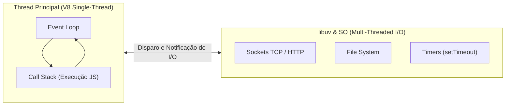
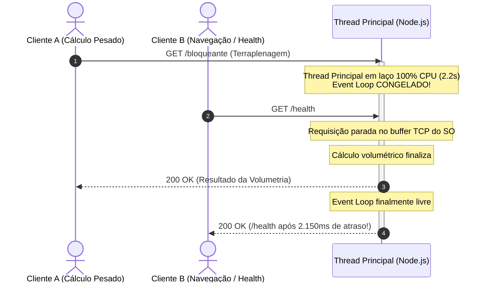
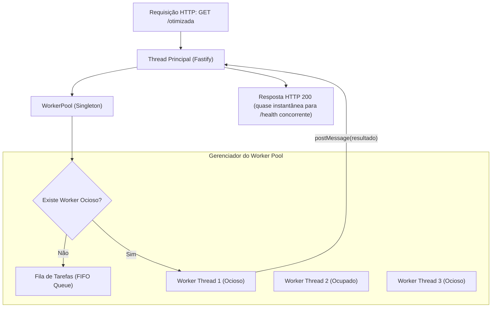

# Guia Prático: O Experimento do Event Loop, Concorrência de CPU e Worker Threads

Este documento aprofunda os conceitos arquiteturais e soluções de engenharia implementadas na **Tarefa 3** do projeto `lab-node-architecture`. Cada tópico aborda:
1. **O que é o conceito?**
2. **Existe no ecossistema Node.js / JavaScript?**
3. **Qual é o problema real em produção?**
4. **Como simular o problema na prática?**
5. **Explicação da solução arquitetural de engenharia (`WorkerPool`)**
6. **Métricas comparativas e lições de produção**

Também disponibilizamos uma demonstração interativa no terminal com `npm run demo:event-loop` e visualmente no arquivo [`docs/laboratorio-interativo.html`](file:///c:/Users/Bruno/Documents/Projetos/labs/lab-node-architecture/docs/laboratorio-interativo.html).

---

## 1. O Que É o Event Loop e Por Que o Node.js é Single-Threaded?

O Node.js foi desenhado prioritariamente para **I/O Não-Bloqueante** (alta taxa de leitura e escrita em rede, bancos de dados e disco). O motor JavaScript V8 executa código em **uma única thread principal**.

Todas as chamadas assíncronas de I/O são delegadas para o sistema operacional ou para a threadpool interna da **libuv**. Quando uma operação de I/O é finalizada, seu callback é registrado na fila do Event Loop para ser processado pela thread principal.



### O Ponto Fraco: Operações Intensivas de CPU (CPU-Bound)
Quando uma requisição dispara uma computação matemática pesada (como cálculo de volumetria geométrica de terreno, criptografia pesada, renderização ou compressão), a **Call Stack da thread principal fica 100% ocupada**.

Durante esse tempo:
- O Event Loop fica **completamente congelado** (*Event Loop Lag* infinito).
- Nenhuma outra requisição HTTP consegue ser aceita ou respondida.
- Requisições simples de verificação de integridade (`/health` ou probes de Kubernetes) não respondem, fazendo o orquestrador reiniciar o pod acreditando que a aplicação travou.

---

## 2. Comparativo de Abordagens de Engenharia

| Abordagem | Consumo de CPU | Bloqueia Event Loop? | Complexidade | Recomendação Arquitetural |
| :--- | :--- | :--- | :--- | :--- |
| **A. Cálculo Direto na Main Thread** | 1 core 100% | **SIM (Congelamento Total)** | Muito baixa | ❌ **Inaceitável em Produção** para tarefas $> 50\text{ms}$. |
| **B. Chunking com `setImmediate`** | 1 core fracionado | **Não**, mas degrada latência | Média | ⚠️ Apenas para tarefas leves divisíveis. |
| **C. `node:worker_threads` com Pool** | N cores paralelos | **NÃO (Thread Isolada)** | Alta | ✅ **Padrão ouro** para tarefas pesadas no mesmo serviço. |
| **D. Processos Filhos (`child_process.fork`)** | Isolamento total de SO | **NÃO** | Alta | ⚠️ Maior consumo de memória RAM por processo duplicado. |
| **E. Fila Assíncrona & Worker Dedicado** | Escalabilidade horizontal | **NÃO** | Muito Alta | ✅ Ideal para jobs que duram minutos/horas (ex: RabbitMQ/BullMQ). |

---

## 3. O Problema Real em Produção (Cenário ArqLab)

Na **ArqLab**, os usuários submetem grandes arquivos de levantamento topográfico e solicitam o cálculo de terraplenagem (balanço compensado de corte e aterro para platôs de implantação de edifícios).

1. O cálculo de um terreno discretizado em malha com milhões de interpolações trigonométricas leva de **2 a 3 segundos de CPU contínua**.
2. **Sem Worker Threads (Cenário A - Rota `/bloqueante`)**:
   - Um único usuário dispara o cálculo às 14:00:00.
   - De 14:00:00 a 14:00:02.5, **nenhum outro usuário consegue navegar na plataforma**.
   - O balanceador de carga (Nginx / ALB) e o Kubernetes enviam `GET /health` de 5 em 5 segundos. Como a API não responde a tempo, o pod é marcado como *Unhealthy* e removido do cluster.



---

## 4. A Solução Arquitetural: `WorkerPool` com `node:worker_threads`

Para resolver o gargalo de forma definitiva sem adicionar dependências externas pesadas, utilizamos o módulo nativo do Node.js: **`node:worker_threads`**.

### Arquitetura do `WorkerPool` ([`src/workers/worker-pool.ts`](file:///c:/Users/Bruno/Documents/Projetos/labs/lab-node-architecture/src/workers/worker-pool.ts))

Criar uma nova Worker Thread a cada requisição é uma **péssima prática de produção**, pois instanciar um novo *V8 Isolate* consome de 50ms a 150ms e aloca dezenas de megabytes de memória.

Nossa arquitetura implementa um **Pool de Threads Persistente**:
1. **Dimensionamento Automático**: Inicializa `N` workers baseado nos núcleos disponíveis (`os.availableParallelism()`).
2. **Rastreamento de Estado**: Mantém controle estrito de workers ociosos (`idle`) e ocupados (`busy`).
3. **Fila FIFO de Tarefas**: Se todos os workers estiverem ocupados, novas requisições aguardam na fila e são despachadas imediatamente assim que uma thread desocupa.
4. **Auto-Recuperação (Self-Healing)**: Se um worker falhar ou morrer inesperadamente com erro não tratado, o pool detecta o evento `error`/`exit`, descarta o worker corrompido, e instancia um novo worker saudável em seu lugar.
5. **Compatibilidade Universal**: Detecta automaticamente se o ambiente está executando em desenvolvimento TypeScript com `tsx` ou em produção compilada `dist/` com JavaScript nativo.



---

## 5. Como Executar e Comprovar na Prática

### Forma A: Demonstração Automatizada no Terminal (Recomendado)
Execute o script de laboratório que dispara as duas rotas em paralelo com requisições de `/health`:

```bash
npm run demo:event-loop
```

**Saída real obtida no benchmark:**
```text
🔴 [CENÁRIO A] ROTA BLOQUEANTE: /bloqueante
   Executando cálculo de volumetria na Thread Principal...
   Disparando 5 requisições concorrentes de /health...
   
   ⏱️  Tempo total do cálculo: 2152.4 ms (executado em main-thread)
   🛑 Latência das requisições de /health durante o bloqueio:
      - Health #1: respondeu em 2136.5 ms ⚠️ REPRESADO!
      - Health #2: respondeu em 2136.3 ms ⚠️ REPRESADO!
      - Health #3: respondeu em 2136.2 ms ⚠️ REPRESADO!

🟢 [CENÁRIO B] ROTA OTIMIZADA: /otimizada
   Offloading do cálculo para o WorkerPool (node:worker_threads)...
   Disparando 5 requisições concorrentes de /health...
   
   ⏱️  Tempo total do cálculo: 4928.8 ms (executado em worker-thread)
   ⚡ Latência das requisições de /health durante a execução do worker:
      - Health #1: respondeu em 6.9 ms ✅ INSTANTÂNEO!
      - Health #2: respondeu em 7.9 ms ✅ INSTANTÂNEO!
      - Health #3: respondeu em 7.8 ms ✅ INSTANTÂNEO!
```

---

### Forma B: Executando a Suíte de Testes Automatizados (Vitest)
Rode os testes unitários e de integração desenvolvidos especificamente para validar o comportamento concorrente do Event Loop:

```bash
npm test
```

Para rodar exclusivamente o teste do experimento de concorrência:
```bash
npx vitest run test/event-loop-experiment.test.ts
```

---

### Forma C: Testando Manualmente via Servidor Local e `curl`

1. Inicie o servidor em modo de desenvolvimento:
   ```bash
   npm run dev
   ```

2. Em um terminal, chame a rota otimizada:
   ```bash
   curl -i "http://localhost:3000/otimizada"
   ```

3. Em outro terminal imediatamente em seguida, chame a rota de saúde:
   ```bash
   curl -i "http://localhost:3000/health"
   ```
   *Resultado: `/health` responde em menos de 5ms enquanto o worker processa o cálculo volumétrico em paralelo.*

---

## 6. Boas Práticas e Cuidados em Produção com Worker Threads

1. **Evite Criar Workers Sob Demanda:** Sempre use um `WorkerPool` reutilizável.
2. **Custo de Serialização de Mensagens (`postMessage`):** Por padrão, os dados trafegados entre a thread principal e os workers passam pelo algoritmo de *Structured Clone*. Para volumes gigantescos de dados (> 100MB), utilize buffers transferíveis (`Transferable Objects` como `ArrayBuffer`) ou `SharedArrayBuffer` com controle de concorrência (`Atomics`).
3. **Não Exceda o Número de Cores de CPU:** Criar mais workers do que os núcleos físicos disponíveis causa degradação de performance por sobrecarga de troca de contexto (*Context Switching*) no escalonador do SO.
4. **Isolamento de Memória:** Cada Worker Thread possui seu próprio heap isolado. Se uma thread sofrer um erro fatal não capturado, ela não derruba o processo principal, desde que o pool trate os eventos de `error` e recrie a thread.
